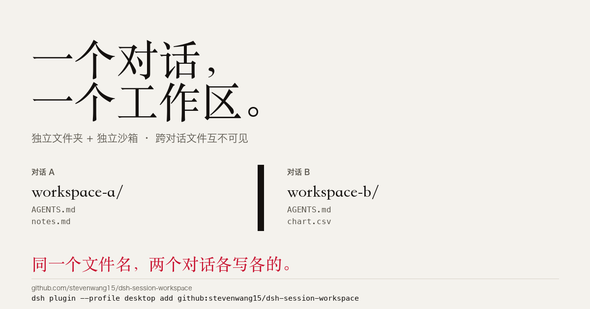

# dsh-session-workspace

> **One folder per conversation.**
> Install once. From then on, every new chat gets its own folder automatically — files from one chat are invisible to every other chat.

English | [中文](README.md)



### 一行安装

```bash
dsh plugin --profile desktop add github:stevenwang15/dsh-session-workspace
```

需要 Node 22+。完整装法、参数与卸载见下文。

---

## The problem (in plain words)

In DeepSeek Harness, **all conversations share one folder**. Picture everyone working at the same desk: a report you started in chat A, a dataset you generated, a file you downloaded — open chat B and it's all still lying on the desk, readable, editable and deletable. The more chats you have, the messier it gets.

This plugin gives **every new conversation its own desk**. Open a new chat, and DSH creates a brand-new folder for it. Everything that chat writes stays in its own folder.

| | Before | After |
|---|---|---|
| Where new chats keep files | all in one folder | one folder per chat |
| Can chat B see chat A's files? | yes | no |
| Extra steps for you | — | none, just click New Session |

## What you'll see after installing

1. Click **New Session** in the sidebar;
2. A new workspace row appears, named after the creation time (e.g. `2026-11-06 20:15`);
3. That conversation works inside `Documents/deepseek-harness/session-workspaces/20261106-201533-a1b2/`;
4. Click New Session again — another fresh workspace and folder;
5. No manual folder creation, no path picking, no settings.

To find the files, open this folder in Finder:

```sh
open ~/Documents/deepseek-harness/session-workspaces
```

## The little switch next to the input box

Once a chat is open, there's a pill at the **far left of the composer toolbar**:

- highlighted **`Isolated`** — new chats automatically get their own folder (the default);
- click to switch to **`Shared`** — the next new chat stays in the folder you picked instead;
- click again to switch back. It's a temporary switch: **a DSH restart restores the default**, and it never edits your config.

> A chat's folder is fixed when the chat is created, so the switch only affects conversations created **afterwards** — it won't move the current one.

## Install (3 steps)

**Step 1 — install the plugin in a terminal**

```sh
dsh plugin --profile desktop add github:stevenwang15/dsh-session-workspace
```

> If that fails, download `dsh-session-workspace-0.2.0.tgz` from Releases and run
> `dsh plugin --profile desktop add file:/absolute/path/to/the.tgz`.

**Step 2 — enable it**

Open `~/.dsh/profiles/desktop/package.json`, find `dsh` → `profile` → `bundles`, and add `"dsh-session-workspace"` to the array:

```json
"bundles": [
  "@deepseek-ai/dsh-base",
  "@deepseek-ai/dsh-web-app",
  …existing entries…,
  "dsh-session-workspace"
]
```

**Step 3 — fully restart DSH**

Quit from the menu bar (**DeepSeek Harness → Quit**, or **Cmd+Q**), make sure **no** DeepSeek Harness process remains in Activity Monitor, then reopen.

> Closing the window and reopening from the Dock is **not** a restart — the background process keeps running and the plugin won't load. This is the number-one gotcha.

## How to check it worked

- An `Isolated` pill appears at the left of the composer toolbar;
- Clicking New Session adds a new workspace row in the sidebar;
- `~/Documents/deepseek-harness/session-workspaces/` gains a new timestamped folder.

## FAQ

**No pill?**
1. Make sure you fully quit and reopened (old processes gone in Activity Monitor);
2. Refresh the page once (Cmd+R / F5);
3. Check that step 2 actually added `"dsh-session-workspace"` to `bundles`.

**Clicked New Session but no new folder?**
These are all expected:

- a leftover blank conversation was reused;
- the composer switch is on `Shared`;
- you started from a **manually added project workspace** — by default it is left alone.

**Nothing changed after an upgrade?**
A local install is a snapshot. Remove first, then install, then fully restart:

```sh
dsh plugin --profile desktop remove dsh-session-workspace
dsh plugin --profile desktop add github:stevenwang15/dsh-session-workspace
```

**Does removing a workspace in the sidebar delete my files?**
No. It only removes the sidebar group; folders and chat history stay.

**Will it hog disk space?**
One folder per chat, same as ordinary folders. Nothing is auto-deleted so you can always go back; delete unused folders yourself.

**Uninstall?**

```sh
./scripts/uninstall-local.sh desktop   # or remove it from bundles and `dsh plugin remove`
```

Workspaces and folders created so far are kept.

---

## For the curious (safe to skip)

### Settings

Append a row to `~/.dsh/profiles/desktop/cordis.patch.yml`:

```yaml
- id: session-workspace
  config:
    enabled: true          # false = plugin completely off
    mode: managed          # managed = leave manual projects alone; all = isolate everything
    baseDir: /Users/you/Documents/deepseek-harness/session-workspaces
```

| Field | Default | Meaning |
|---|---|---|
| `enabled` | `true` | Master switch. `false` behaves as if not installed. |
| `mode` | `managed` | `managed`: isolate the default workspace and plugin-created ones, leave manually added project workspaces shared. `all`: isolate every new conversation. |
| `baseDir` | sibling of the default workspace | Where per-conversation folders live. |

### How it works

In DSH a “workspace” is a directory: the `cwd` recorded at session creation is both the session's **sandbox root** (writes are confined to it) and the sidebar grouping key.

- **Host half (`index.js`)** wraps `ctx.sessionController.create`. For a new conversation it exclusively creates a directory, registers it as a Workspace, and creates the session through it, so the session's `cwd` is the new directory. Explicit `cwd`s, blank-session reuse and manually added project workspaces keep their stock behavior; allocation failures fall back to the original request so conversation creation never breaks. A small control API (`GET/POST /api/session-workspace/{state,enabled}`) is registered through the kernel `connection` Fetch routes, so the Host's own auth and owner checks apply.
- **Browser half (`client.js`)** is a hand-written `__ModuleLoader__` bundle (no build step; only the shell-provided React) that registers the pill in the `conversation.input.left` slot and follows the light/dark theme.

### Compatibility

- Fully tested on **DSH 0.2.2-rc.1**. Isolation only relies on public DSH services; if a future release drops the composer slot, the pill simply doesn't render — **isolation keeps working**.

### Development & tests

Zero dependencies, no build step:

```sh
npm test                 # 28 tests (host unit 21 + browser half 2 + contract 5)
npm run e2e              # real DSH Host: isolation / blank reuse / explicit cwd
npm run e2e:control      # real DSH Host: control API + browser bundle publication
```

E2E boots an isolated `DSH_HOME` under `.e2e*`; it never touches your `~/.dsh` and spends no LLM tokens. See [docs/E2E.md](docs/E2E.md).

## License

[MIT](LICENSE)

## The DSH plugin family

| Plugin | In one line |
| :--- | :--- |
| [dsh-caveman](https://github.com/stevenwang15/dsh-caveman) | 让 agent 少说废话、多留事实 |
| [dsh-taste-skill](https://github.com/stevenwang15/dsh-taste-skill) | 前端设计：先定方向，再量，再看 |
| [dsh-session-workspace](https://github.com/stevenwang15/dsh-session-workspace) | 一个对话，一个独立工作区 |

---

Found a bug or want a feature? [Open an issue](https://github.com/stevenwang15/dsh-session-workspace/issues/new/choose). If this plugin helps you, a ⭐ helps others find it.
